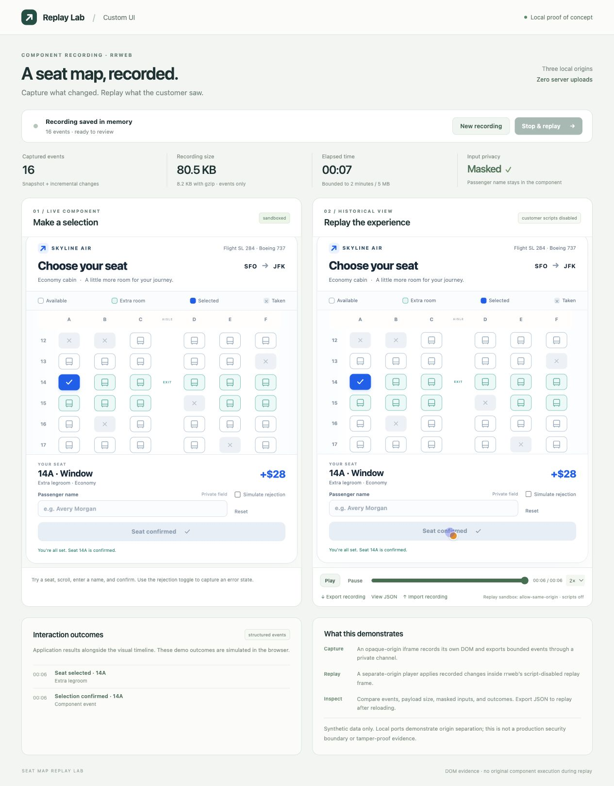

# Seat Map Replay Lab

A local, component-scoped rrweb proof of concept for reviewing a historical custom UI without rerunning the original component JavaScript. It uses a new synthetic airline seat map, not the supplied production HTML or customer code.

## Run

Requires Node.js 22.12 or newer.

```sh
cd /Users/alex.su/Develop/Test/seat-map-rrweb-poc
npm ci
npm run dev
```

Open **http://127.0.0.1:8787**. The server binds to loopback only. `npm run dev` builds once and starts four servers; it does not watch files. After editing, run `npm run build` and refresh. Stop with Ctrl+C. To serve an existing build, use `npm start`. Set `PORT=9000 npm run dev` to use ports 9000–9003 instead.

If your default npm cache is not writable, use `npm --cache /private/tmp/seat-map-rrweb-npm-cache ci`.

## Try it

1. Recording starts automatically. Select a seat and scroll the seat map.
2. Enter a synthetic passenger name. All input text is masked before events leave the component.
3. Toggle **Simulate rejection** and confirm, then clear the toggle and confirm again.
4. Click **Stop & replay**. The historical view initially shows the last recorded state.
5. Use Play, Pause, the timeline, and playback speed to review changes. The outcome list shows selections and simulated submission results.
6. Export the recording as JSON, reload, then import it. Importing unloads the live component, demonstrating that the historical view does not need its JavaScript.

For a ready-made example, import `examples/seat-map-demo.json`. It records selections 10D → 11F → 21E and a successful confirmation. Start a fresh session with **New recording**.



## New experiments

See [the verified masking, image, bundle-size, and final-snapshot findings](docs/EXPERIMENTS.md).

- A read-only synthetic passport span is masked, including updates.
- Compare cross-origin CORS/no-CORS images, a public HTTPS image, and an embedded base64 image.
- Toggle image embedding for a new recording and URL-image access for replay.
- Choose **Final snapshot only**, then **New recording**, to export just the final DOM with no cursor/history.
- Import `examples/final-url.json` or `examples/final-inline.json` for saved examples. The bare `final-frame.events.json` targets the rrweb API directly, rather than the demo importer.

## Architecture

| Local origin | Role | Isolation |
| --- | --- | --- |
| `127.0.0.1:8787` | Host controls, metrics, export/import | Parent document |
| `127.0.0.1:8788` | Live seat map plus rrweb recorder | `sandbox="allow-scripts"`; opaque origin |
| `127.0.0.1:8789` | Trusted rrweb player application | Separate origin; outer frame allows scripts and same-origin |
| `127.0.0.1:8790` | Synthetic external PNG fixtures | Public image-only origin; CORS and no-CORS variants |
| Inside player | Reconstructed DOM | rrweb frame has exactly `sandbox="allow-same-origin"`; scripts disabled |

The recorder runs inside the live component, so the parent does not need direct access to its DOM. Startup validates the expected window, instance ID, protocol, and origin before transferring a private MessageChannel. The opaque runner origin is expected to be `"null"`; that value alone is never treated as authentication.

rrweb 2.2.0 captures an initial DOM snapshot with inline styles, followed by DOM mutations, input state, clicks, and scroll changes. The player reconstructs that event stream; it does not restart the seat-map application or resubmit its actions. Structured outcome events are recorded separately so visual evidence can be compared with the application's reported results.

## Data and size

- Recordings stay in browser memory until exported. Refreshing loses an unexported recording.
- Import/export uses local JSON files. There are no recording uploads, API requests, database writes, or analytics. The image experiment loads a public HTTPS image and local image fixtures; URL-based replay can fetch those assets again.
- Limits: 2 minutes, 10,000 rrweb events, 100 outcomes, and 5 MiB per recording. Imports also bound viewport size and full-snapshot node count/depth.
- Metrics show UTF-8 event JSON size and actual browser gzip size. The exported envelope also contains metadata and outcomes, so its size is slightly larger.
- The included 38-event sample is approximately **85.5 KB of event JSON / 8.7 KB gzip**. This is one synthetic interaction, not a production average.
- At 1,000 similar custom UI recordings/day, that would be about **85.5 MB/day raw / 8.7 MB/day gzip**, or **2.57 GB / 261 MB over 30 days**, before metadata, replicas, indexes, requests, or delivery costs. Plain text messages do not create recordings in this design.

## Privacy and security boundaries

The runner masks all input text and text under `[data-private]`; `[data-recording-exclude]` omits marked subtrees. Browser verification confirmed that a typed name was absent from exported events. Checkbox state and nonprivate DOM text remain visible. Masking does not automatically cover sensitive values placed in other text, attributes, URLs, styles, or application outcomes. Review each component's data surface before production use.

The servers restrict files, methods, framing, and permissions. CSP blocks fetch connections, external fonts, forms, objects, and arbitrary external scripts. Images allow only data URLs and the explicit fixture/public-image origins, with URL access removable during replay; the demo's styles are embedded. Replay verifies the script-disabled inner sandbox. Validation bounds common malformed inputs, but is not a comprehensive sanitizer for every rrweb incremental-event payload.

Different ports provide distinct browser origins for this demo. They do not model a separate registrable production domain or isolate CPU and memory. Production adoption still needs Security review of domain/cookie separation, event validation, asset handling, tenant authorization, encryption, storage/retention/deletion, resource limits, and revocation. A recorder running with untrusted component code is not tamper-proof evidence; the component can influence its own DOM and reported outcomes.

## Scope and limitations

- Intended for DOM/CSS/SVG components. Canvas/WebGL recording and canvas replay are disabled; fonts and media are not supported. Image handling, CORS, and embedding limitations are documented in the experiments report.
- Mouse movement and mouse interaction recording are disabled; the replay cursor is hidden and scroll sampling is throttled. This favors compact component review over full session analytics.
- Replay preserves recorded visual state and timing. It is not an interactive Simulator, a new execution of business logic, or a guarantee of identical pixels across browsers.
- Outcomes are simulated in the browser. A production design should correlate them with independently recorded server results.
- The sample component is self-contained; arbitrary third-party components and authenticated assets need additional work.

## Checks and files

```sh
npm test
npm run typecheck
npm run build
```

The focused Node tests compile the real protocol module and exercise import format, limits, chronology, viewport, outcomes, and malformed full snapshots. Browser checks covered recording, selection, rejection/success, input masking, stop/replay, exported JSON, saved-recording import, and the replay sandbox. This is a working PoC, not a production security audit.

- `src/seat-map.ts`, `seat-map.css`: synthetic component
- `src/runner.ts`: bounded recorder and private channel
- `src/host.ts`, `host.css`: controls, metrics, file import/export
- `src/player.ts`, `player.css`: rrweb reconstruction and playback
- `src/protocol.ts`: recording format and validation
- `scripts/server.mjs`: four local servers and response policies
- `tests/protocol.test.mjs`: import and boundary regressions
- `examples/seat-map-demo.json`: recorded example

No credentials are used. Dependencies come from the public npm registry. No Git repository or commit is created by this setup.
