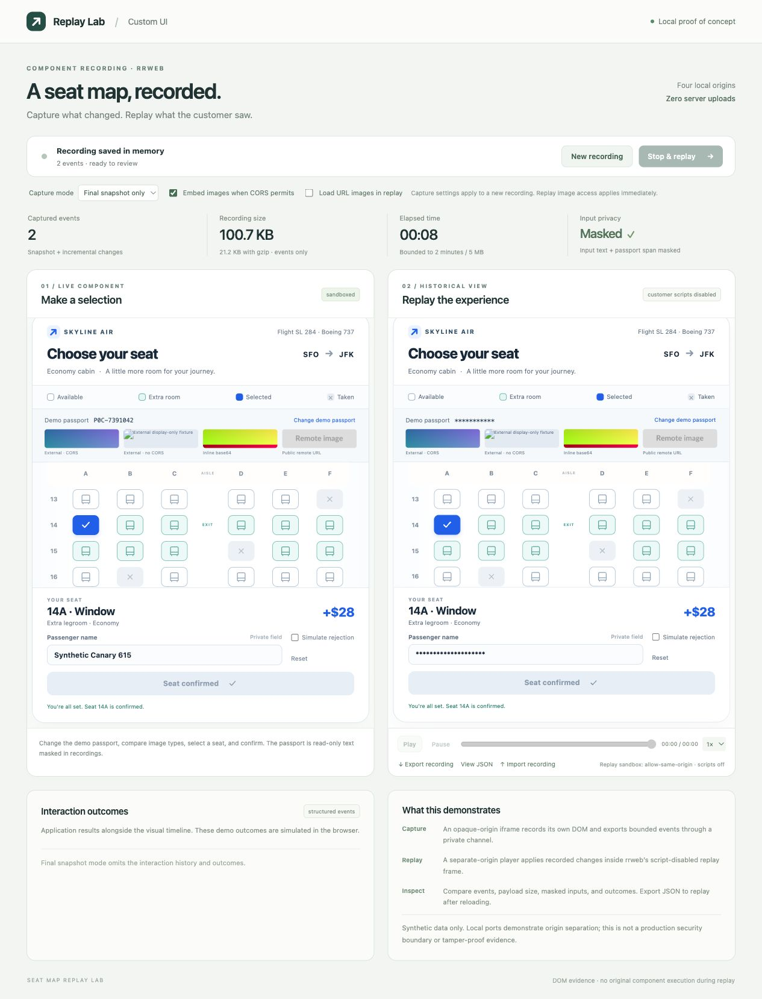

# rrweb masking, images, bundle cost, and final snapshots

Verified in the local Seat Map Replay Lab against rrweb 2.2.0. All identities and images in the fixtures are synthetic. Sizes use decimal KB (1,000 bytes). The browser checks used the actual iframe/channel/recorder/player paths, not a mocked serializer.



## 1. A read-only passport span can be masked

The component contains a read-only `<span id="passport-value" data-private>` with a synthetic passport value and a button that replaces its text. The recorder uses:

```ts
record({
  emit,
  maskAllInputs: true,
  maskTextSelector: '[data-private]',
});
```

Browser verification found neither the initial `P0C-4829017` nor replacement `P0C-7391042` in the exported JSON. A mutation was recorded with masked text, and replay displayed `***********`. Final-state captures also excluded the typed synthetic passenger-name canary.

This is text-node masking, not just form-input masking. Set the marker before rendering private content. It does not scrub arbitrary attributes (`title`, `aria-label`, `data-*`), URLs, image pixels, structured outcomes, or previously recorded events. The default mask preserves length/whitespace; use a fixed `maskTextFn` if length must also be hidden, or `blockSelector` to omit a whole subtree. None of these are protection against malicious code controlling the recorder itself.

## 2. URL and base64 image experiments

Four images are included: a cross-origin CORS-enabled PNG, a cross-origin PNG that allows display but omits CORS, an embedded base64 PNG, and a public HTTPS PNG from placehold.co. The first two are deterministic local fixtures on port 8790, modeling an asset origin independently from the opaque component origin.

All four loaded in the live component before capture. With `inlineImages:false`, all four also rendered during normal replay. Inspecting the recording showed the original URL in each external image's `src` and the complete data URL in the base64 image's `src`.

| Image | Default recording | Replay URL access disabled | `inlineImages:true`, URL access disabled |
| --- | --- | --- | --- |
| External PNG with CORS | URL reference | Fails to load | Renders from `rr_dataURL` |
| External PNG without CORS | URL reference | Fails to load | Fails; no embedded bytes |
| Inline base64 PNG | Data URL already in JSON | Renders | Renders; additional encoded copy appears |
| Public HTTPS PNG with CORS | URL reference | Fails to load | Renders from `rr_dataURL` |

The checkbox **Load URL images in replay** changes the player response's image CSP and reconstructs the recording. Turning it off blocks URL images while permitting `data:` images. This is a controlled asset-availability test; the player application itself still runs from the local server.

`inlineImages:true` uses canvas to capture loaded image pixels and writes a data URL to the special `rr_dataURL` attribute. The demo requests PNG. CORS-readable sources set `crossOrigin="anonymous"` before `src`; their server must permit the request (the local public fixture sends `Access-Control-Allow-Origin: *`). The opaque-origin frame makes even a URL on its server cross-origin for canvas purposes.

Important observed side effect: rrweb retried the display-only PNG with anonymous CORS, and it became broken in the live component. A visible image is not necessarily canvas-readable. Avoid relying on that fallback in production; choose the asset/CORS policy deliberately.

The original `src` remains alongside `rr_dataURL`. The existing base64 `src` was 15,046 characters; inlining added a second 1,102-character encoded representation. PNG encoding produced different sizes for the same source image; canvas may also change color representation or metadata. Thus enabling inlining everywhere can duplicate bytes and change encoding. Rebuild also processes ordinary attributes, so `rr_dataURL` alone is not a guarantee that original URLs will never be requested. Maintain an appropriate replay CSP or a reviewed asset-normalization layer.

Record after asset readiness. rrweb does not return a promise that waits for all images; asynchronous callbacks may modify its original snapshot after emit. This demo waits up to four seconds for image decode, then freezes each emitted event before size checking and channel transfer. Late/failed assets may remain URL references and require another capture. Large photographic images can dominate the recording even when DOM history is small.

## 3. Bundle impact

Measured minimal production browser ESM bundles with esbuild 0.28.2, minification, tree shaking, no source maps, and rrweb 2.2.0. Compression is gzip level 9 / Brotli quality 11 per emitted file. Player rows include its CSS.

| Import choice | Raw KB | gzip KB | Brotli KB |
| --- | ---: | ---: | ---: |
| Recorder: `@rrweb/record` | 75.77 | 23.49 | 20.98 |
| Player: `@rrweb/replay` + CSS | 201.92 | 64.49 | 40.79 |
| Both, shipped as separate bundles | 277.69 | 87.97 | 61.77 |
| Both split packages in one build | 277.96 | 87.49 | 57.66 |
| Both from unified `rrweb` in one build | 266.06 | 83.46 | 57.02 |

The installed split distributions are flattened bundles, so simply bundling them together does not merge all equivalent internals. The unified package is slightly smaller for both APIs together, but a recorder-only import from it measured 182.36 KB raw / 58.03 KB gzip. Use the recorder-only package in a widget that does not replay. Load the player in Director or lazily when opening the historical view.

These are isolated library-containing bundles, not an exact increase measured against an existing application. Shared modules, import paths, bundler options, chunking and caching affect real deltas. Dynamic imports defer download; runtime flags do not necessarily remove feature code. The local demo server does not compress responses, so these are production-delivery estimates rather than its observed network transfer sizes.

Reproduce from the project root:

```sh
node docs/bundle-study/measure.mjs
```

See `docs/bundle-study/RESULTS.md` and `results.json` for exact measurements and generated input variants. The script writes generated comparison bundles under that folder and does not alter the application build.

## 4. Final-state capture with no cursor

Choose **Final snapshot only**, click **New recording**, interact, then click **Stop & replay**. The event count remains zero during the session. On stop the demo initializes rrweb against the current DOM, keeps only Meta + FullSnapshot, stops its observers immediately, and exports no interaction outcomes. It does not collect a timeline and then discard it. Replay correctly showed the final confirmed seat 14A, masked passport, and masked passenger input.

Two events are the minimum for this Replayer path. Taking only the last event from a normal recording does not work: that event can be an incremental change that depends on the initial DOM. A fresh FullSnapshot contains the current tree, styles, input properties and scroll state.

The demo also disables `sampling.mousemove` and `sampling.mouseInteraction` for full timelines, and hides `.replayer-mouse` / `.replayer-mouse-tail` in the player. `mouseTail:false` by itself hides only the trail. Browser inspection confirmed no pointer event sources in the timeline and an invisible replay cursor.

Measured browser exports (complete compact recording envelope):

| Saved example | Events | Raw KB | gzip KB |
| --- | ---: | ---: | ---: |
| `timeline-url.json` | 7 | 98.746 | 18.229 |
| `final-url.json` | 2 | 95.633 | 17.717 |
| `timeline-inline.json` | 7 | 104.083 | 21.839 |
| `final-inline.json` | 2 | 100.970 | 21.329 |

The short timeline performed the same passport update, seat selection and confirmation; final captures also included a synthetic masked input. Timings differ. Removing history saved about 3.2% raw / 2.8% gzip for the URL case. This is a small interaction with a large initial DOM and base64 asset; savings grow with mutation-heavy/long sessions, while each final DOM remains necessary.

`examples/final-frame.events.json` is an even smaller bare two-event array: 95,398 bytes, removing the demo envelope. Feed it directly to `new Replayer(events, ...)`; the demo Import button deliberately expects the validated recording envelope, so import `final-url.json` there. For repeated snapshots, image-byte deduplication, retained versioned assets, and compressed storage can offer larger savings than dropping cursor coordinates alone.

A dedicated snapshot implementation can use `snapshot(document, options)` from `rrweb-snapshot` and wrap it with metadata for this player, avoiding the brief recorder initialization. The built PoC reuses the existing recorder package on demand. A safe static DOM viewer using the snapshot library could also reduce player code, but that alternative was not measured here. Complex adopted stylesheets, nested frames, canvas and late assets need separate validation.

## Verification and evidence

For a controlled comparison that includes cursor events, see [the same-session cursor study](cursor-study/RESULTS.md). It compares the original timeline, that exact timeline with pointer/interaction sources removed, and a fresh final snapshot from the same session.

`npm run build`, `npm run typecheck`, and the protocol suite passed (38 tests/subtests). The new protocol cases enforce final mode's two-event structure, outcome omission and capture-option validation. Browser evidence is saved in `examples/{timeline,final}-{url,inline}.json`; `docs/recording-sizes.json` contains byte counts and per-image serialized lengths.

Expected console errors occur when replay CSP deliberately blocks URL images and when the no-CORS fixture rejects rrweb's anonymous-CORS retry. These are the tested failure cases. Replay retains its script-disabled inner iframe; only the explicit image-source allowlist changes. No credentials are used.
